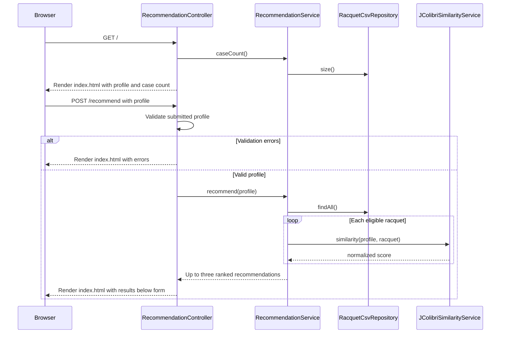

# Tennis Racquet Case-Based Recommender

This project is a browser-based tennis racquet recommender built with Java 17, Spring Boot, Thymeleaf, Apache Commons CSV, and jCOLIBRI. It represents each racquet as a case, compares a submitted player profile with the bundled case base, filters out ineligible candidates, ranks the rest by a weighted similarity score, and displays up to three recommendations.

The case base is bundled at `src/main/resources/data/racquets1.csv`. The current file contains 1,251 usable records. The app loads the file into memory at startup; it does not use a database.

## Contents

- [Requirements and run instructions](#requirements-and-run-instructions)
- [Application flow](#application-flow)
- [Project structure](#project-structure)
- [Case base and data loading](#case-base-and-data-loading)
- [Player profile and form behavior](#player-profile-and-form-behavior)
- [Eligibility and similarity scoring](#eligibility-and-similarity-scoring)
- [Recommendation output](#recommendation-output)
- [LOOCV evaluation](#loocv-evaluation)
- [Limitations](#limitations)

## Requirements and Run Instructions

Install Java 17 and Maven. From the project root, run:

```bash
mvn spring-boot:run
```

Open `http://localhost:8080`. The configured default port is in `src/main/resources/application.properties`. To use another port, pass a Spring Boot argument, for example:

```bash
mvn spring-boot:run -Dspring-boot.run.arguments=--server.port=8081
```

To package and run the application:

```bash
mvn clean package
java -jar target/tennis-racquet-cbr-1.0.0.jar
```

Run the automated tests with:

```bash
mvn test
```

The current test suite checks that the Spring application context loads successfully; it does not contain dedicated tests for recommendation quality or scoring.

## Application Flow



The recommendations are rendered on the same page as the form. The separate `results.html` template remains in the project, but the current controller returns `index` for both the initial page and recommendation submissions.

## Project Structure

```text
src/main/java/com/example/racquetcbr/
  RacquetCbrApplication.java             Spring Boot entry point
  model/
    PlayerProfile.java                    Form/query model and validation
    RacquetCase.java                      One racquet in the case base
    Recommendation.java                   Ranked result data
  service/
    RacquetCsvRepository.java             CSV loading and case storage
    JColibriSimilarityService.java         Similarity configuration and scorer
    RecommendationService.java             Filtering, ranking, explanations
  web/
    RecommendationController.java         GET and POST routes
src/main/resources/
  application.properties                  App name, port, template cache
  data/racquets1.csv                       Bundled case base
  static/css/app.css                       Page and result styling
  templates/index.html                     Profile form and inline results
  templates/results.html                   Retained, currently unused template
src/test/java/com/example/racquetcbr/
  RacquetCbrApplicationTests.java          Spring context-load test
```

## Case Base and Data Loading

`RacquetCsvRepository` loads `data/racquets1.csv` once during Spring startup using Apache Commons CSV. Records with a blank `slug` are ignored. The repository exposes an unmodifiable list to recommendation code and supplies the count displayed on the homepage.

The app maps the case fields it needs, including:

| Case attribute | CSV field(s) | Use |
| --- | --- | --- |
| Identity | `slug`, `brand`, `model`, `year` | Identity, display name, and filtering the held-out case during evaluation |
| Player fit | `Age group`, `Player level`, `Primary style` | Eligibility and profile similarity |
| Playing characteristics | `Arm sensitivity`, `Power preference`, `Spin preference`, `Control preference` | Safety eligibility and categorical similarity |
| Specifications | `weight`, `head_size`, `swingweight`, `balance_mm`, `string_pattern`, `ra` | All are loaded into the case model; weight and head size affect live scoring |
| Recommendation detail | `summaries_expert_en`, `recommended_string_type` | Expert case summary and suggested string display |

For selected fields, the repository accepts both snake-case names and title-case aliases, such as `primary_style` or `Primary style`. Blank and invalid numeric values are represented as `null`, not zero. This matters because zero would otherwise be treated as a real measurement. Other source columns not mapped by `RacquetCsvRepository` are ignored by the recommender.

The app uses the case base as supplied. It does not independently verify product specifications or expert classifications before recommending a racquet.

## Player Profile and Form Behavior

The profile consists of:

- Age group
- Player level
- Primary playing style
- Arm sensitivity
- Power, spin, and control preferences
- Optional preferred weight
- Optional preferred head size
- Optional brand preference

The initial form defaults to Adult, Intermediate, Balanced, Medium arm sensitivity, Medium power/spin/control preferences, 285 g, 100 in^2, and no brand preference.

The form's categorical options are aligned with values supported by the case base. The age-group choices are Adult, Adult/Senior, and Junior/Youth. When Junior/Youth is selected, browser-side JavaScript automatically selects player level `Junior` and primary style `Junior/Development`.

Weight and head-size dropdowns include `Any weight` and `Any head size`. Selecting either blank option binds that preference as `null`; the corresponding numeric similarity factor is skipped and its proximity explanation is omitted. Available measurements are drawn from the case-base values. Brand is a dropdown with `Any brand` and the brands represented by the case base.

`PlayerProfile` validates required categorical fields as nonblank. Preferred weight is nullable and constrained to 150-400 g when supplied; preferred head size is nullable and constrained to 70-140 in^2. The UI options provide the normal user input path, while the annotations also protect submitted values.

If validation fails, the controller returns the form page instead of generating recommendations. The current template does not explicitly display field-level validation messages.

## Eligibility and Similarity Scoring

### Eligibility filters

Before scoring, `RecommendationService` applies two filters:

1. Junior compatibility: a Junior/Youth profile can match only a racquet classified as junior by its age group, player level, or primary style. Non-junior profiles cannot match those junior cases.
2. Arm-safety filter: a profile with High arm sensitivity excludes racquets classified as High arm risk.

These are exclusions, not score penalties. A filtered racquet cannot appear in the results regardless of its similarity score.

### Weighted similarity

`JColibriSimilarityService` computes the score used to rank candidates. Its custom scorer compares the profile to each candidate and normalizes by the total weight of the factors that are available for that comparison:

| Factor | Weight | Scoring behavior |
| --- | ---: | --- |
| Player level | 0.20 | Exact categories score highest; mapped levels receive a decreasing score as their rank difference grows |
| Primary style | 0.18 | Exact styles score highest; related style terms receive partial similarity |
| Arm sensitivity / racquet arm risk | 0.15 | Rewards compatible risk and sensitivity; missing or unknown values receive a neutral fallback |
| Preferred weight | 0.12 | Linear proximity, with a 50 g tolerance; omitted if either value is missing |
| Power preference | 0.08 | Ordinal Low/Medium/High comparison; omitted for unknown values |
| Spin preference | 0.08 | Ordinal Low/Medium/High comparison; omitted for unknown values |
| Control preference | 0.08 | Ordinal Low/Medium/High comparison; omitted for unknown values |
| Preferred head size | 0.05 | Linear proximity, with a 15 in^2 tolerance; omitted if either value is missing |

Numeric proximity is calculated as `max(0, 1 - absoluteDifference / tolerance)`. The custom scorer renormalizes the result when optional measurements or categorical preferences are absent. Unknown categorical values are treated as missing where the scorer explicitly checks for them; player level, style, and arm comparisons use their own fallback scores.

### jCOLIBRI configuration note

The project depends on jCOLIBRI 3.2 and creates a jCOLIBRI `NNConfig` with explicit attribute weights. However, the returned web recommendations are calculated by the custom `similarity()` method described above; the `NNConfig` is not passed into that ranking operation. The configuration lists additional weights for swingweight, balance, and string pattern, but the current custom scorer does not include those three attributes. They therefore do not currently affect the displayed recommendation score.

### Brand preference, rank, and confidence

With no brand preference, the similarity score is unchanged. When a brand is selected, the final score is:

```text
finalScore = 0.85 * similarityScore + 0.15 * brandMatch
```

`brandMatch` is 1 for a case-insensitive exact brand match and 0 otherwise. The service sorts eligible racquets by final score, descending, and returns at most three; in recommendation terms, K is 3. Scores are displayed as percentages to one decimal place.

Confidence labels are derived from the final score: High at 0.80 or above, Medium at 0.65 or above, otherwise Low. They are score bands, not calibrated probabilities.

The service also adds explanations for exact player-level/style matches, preferred weight/head-size proximity, and cautions for high arm risk or missing specifications. Recommendations include an expert case summary and the case's suggested string where those fields are available.

## LOOCV Evaluation

The standalone report [EVALUATION_LOO_CASE_COVERAGE.md](EVALUATION_LOO_CASE_COVERAGE.md) describes a Leave-One-Out Cross-Validation (LOOCV) similarity-coverage calculation:

- One fold was run for each of the 1,251 case-base records.
- In each fold, the held-out case was excluded from its candidate pool and used to build a synthetic query from its available fields.
- A fold counted as covered if at least one other eligible case scored strictly above 90% using the displayed one-decimal score.
- 1,146 of 1,251 folds were covered: **91.61%**. The remaining 105 had no eligible case above the threshold.

This is a similarity-threshold coverage rate, not conventional predictive accuracy or measured user success. Queries are synthesized from racquet cases rather than real player profiles, and the case base does not include expert approvals or player outcome labels. Similar or duplicate products may remain in a fold after the exact held-out row is removed.

The older [EVALUATION.md](EVALUATION.md) reports 97.02% for a different scope: 1,175 profiles whose player-level and primary-style values were compatible with the web form. Its denominator and query construction differ, so the two percentages should not be compared as if they were the same evaluation.

## Limitations

- Similarity measures profile resemblance, not whether a player will like or perform well with a racquet.
- The LOOCV queries are generated from racquet records and can overstate performance on real player profiles.
- Missing values reduce the factors available to compare; normalization keeps them from being treated as zero but does not restore missing information.
- The current custom score does not use swingweight, balance, or string pattern, despite those fields appearing in the jCOLIBRI configuration.
- Source classifications and product specifications should be reviewed before using the recommendations as authoritative advice.
- The output is informational and is not medical advice. Players with active arm pain should consult a qualified clinician or racquet technician.